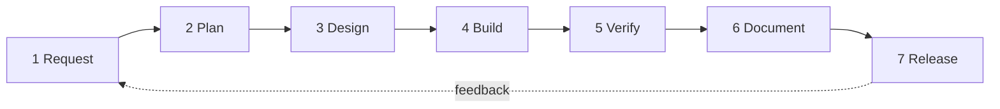

# Development lifecycle

How work moves from idea to release in this repo. It applies to humans and AI agents alike.

## Phases



### 1. Request
Capture it in the user's words. Check [FEATURES.md](FEATURES.md) and [DECISIONS.md](DECISIONS.md) first: is it already done, already a known gap, or does it conflict with a decision?

### 2. Plan
- Map the change against [MAP.md](MAP.md): which files does it touch?
- If it changes product behavior, update [PRD.md](PRD.md) or [SYSTEM_SPEC.md](SYSTEM_SPEC.md).
- Ask the user only for decisions that are genuinely theirs (tone, scope, trade-offs).

### 3. Design
- UI follows [../DESIGN.md](../DESIGN.md) and [../PRODUCT.md](../PRODUCT.md). Reuse `glass.dart` components; add a new shared component there only when two or more screens need it.
- Every interactive element needs default, pressed, disabled and focus/semantics states.

### 4. Build
- Match the surrounding code style. Keep changes scoped to the request.
- No hardcoded colors; use `context.palette`.
- New dependencies need a reason recorded in DECISIONS.md.

### 5. Verify
```bash
export PATH="$PATH:/c/Users/AmanSharma/flutter/bin"
flutter analyze          # must be "No issues found"
flutter test             # must pass
flutter build web --release
python -m http.server 8080 --directory build/web
```
Then look at it: phone width (about 400px), dark and light, the affected screens. Check reduced motion where animation changed.

### 6. Document
Add a [HISTORY.md](HISTORY.md) entry. Update MAP, FEATURES and DECISIONS as needed. Fix [SYSTEM_SPEC.md](SYSTEM_SPEC.md) if behavior changed.

### 7. Release
- Commit on a branch. Commit messages end with the co-author line required by the harness.
- Deploy: push to the branch Vercel builds from (`vercel.json` → `vercel-build.sh`).
- Bump `version:` in `pubspec.yaml` for user-visible releases and note it in HISTORY.

## Definition of done

- [ ] Analyzer clean, tests green
- [ ] Verified visually in the web build (dark and light)
- [ ] HISTORY entry added; MAP and FEATURES current
- [ ] No new known gaps left unlogged

## Testing strategy

| Level | Now | Target |
|---|---|---|
| Unit | `LifeCalculator` lifespan math | Free-time formulas, predictor, streak logic |
| Widget | Splash smoke test | Home renders with a seeded `AppState`; FlipTile settles on the new digit |
| Visual | Manual Playwright screenshots | Golden tests for the flip clock and home |

## Current phase (2026-11-02)

v2 redesign built and verified locally. Not yet committed or deployed. Next candidates are in the [roadmap](FEATURES.md#roadmap).
