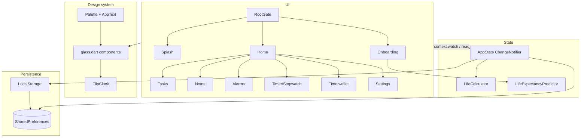

# System design

## Stack

| Layer | Choice |
|---|---|
| UI framework | Flutter 3.47 (Dart 3.13), Material 3 base with Cupertino widgets |
| State | `provider` with one `ChangeNotifier` (`AppState`) |
| Storage | `shared_preferences` (localStorage on web) |
| Fonts | `google_fonts`: Inter (UI) and DotGothic16 (clock labels), fetched at runtime |
| Animation | Implicit/explicit Flutter animations; `flutter_animate` for the splash fade and the check-in banner |
| Other | `intl` (dates, numbers), `uuid` (ids) |
| Targets | Web (primary, deployed on Vercel), iOS, Android, macOS, Windows, Linux |

## Architecture

### Layers and their rules
- **Screens** compose design-system widgets and read state with `context.watch<AppState>()`. They mutate only through `AppState` methods.
- **AppState** owns all collections and preferences, rebuilds `LifeCalculator` whenever the profile or allocations change (`_recomputeLife`), and calls `notifyListeners()`.
- **LifeCalculator** is pure: computed from `DateTime.now()` on every access, with no timers inside.
- **Time-driven UI** owns its own timers: the home ticker (500 ms), the backdrop refresh (30 s), timer/stopwatch, flash reminders. Each one cancels in `dispose`.

## Design system

Specified in [../DESIGN.md](../DESIGN.md). In short:
- `Palette` is a `ThemeExtension` registered in `ThemeData.extensions`; read it with `context.palette`.
- `GlassPanel` = `ClipRRect` + `BackdropFilter(blur 28)` + translucent fill + 1px stroke + top sheen.
- `GlassBackdrop` is a `CustomPainter` with three radial gradients over the canvas, wrapped in a `RepaintBoundary`. It is static, so the blur layers above it do not re-rasterize every frame.
- Lists use iOS-style inset grouping (`GlassGroup`/`GlassRow`): one panel with many rows instead of one blur per item, which keeps the number of backdrop filters low.

## Flip clock rendering

- Each `FlipTile` paints a 5x7 glyph with `_DotGlyphPainter` on an **opaque** face so the flaps can hide what is behind them.
- When a digit changes, a 560 ms controller runs. Static layers: new top half, old bottom half. Moving flap: first the old top half rotates 0 to −90° about the hinge, then the new bottom half rotates 90 to 0°. A perspective entry (0.004) and a darkening shade give depth.
- The tile size derives from `cell` (dot pitch): big 9, small 3.6. The whole clock is in a `FittedBox(scaleDown)` for narrow screens.

## Navigation

`Navigator.push(CupertinoPageRoute)` everywhere. The theme forces `CupertinoPageTransitionsBuilder` on all platforms (swipe back on iOS). Sheets go through `showGlassSheet` (modal bottom sheet, transparent background, glass panel).

## Performance notes

- Home rebuilds once per second (only when the second changes).
- Backdrop filters are expensive on web (CanvasKit). Avoid one per list row; group rows.
- The stopwatch ticks every 30 ms but only while running.

## Deployment

- **Vercel:** `vercel.json` runs `bash vercel-build.sh` (clones Flutter stable, `flutter build web --release`) and serves `build/web`.
- **Local:** `flutter build web --release`, then `python -m http.server 8080 --directory build/web`. Stop the server before rebuilding on Windows.
- Web assets: `web/index.html`, `manifest.json`, favicon and icons (hourglass).

## Security and privacy

No network calls except Google Fonts. No accounts. All personal data (birth date, habits-based estimate) stays in local storage on the device.
